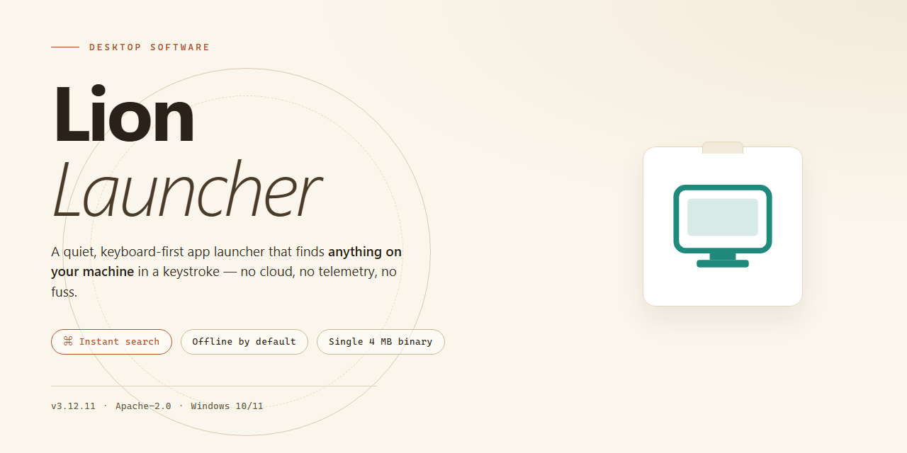

# Lion Launcher: Fast, Extensible App Launcher for Windows 11

### 📦 PowerShell Install Button

  

---

Lion Launcher is a lightweight, cross-platform desktop launcher for Minecraft, built in Rust with Tauri for a fast and responsive user experience on both Linux and Windows. It provides full profile management with support for Vanilla, Fabric, Quilt, Forge, and NeoForge, allowing each profile to maintain its own mods, settings, and resource packs. An integrated Modrinth browser enables searching, filtering, and one-click installation of mods directly within the application. Microsoft and Xbox account authentication is handled through the device code flow, with offline account support and 3D skin previews also included. The application features a minimalist gray interface with customizable accent colors and a compact bundle size.

## 🔧 Requirements

- **PowerShell 5.1+** (pre-installed on Windows 10 and 11)
- **Windows 10 / 11** (x64)
- **Internet connection** — required to fetch the script
- **Administrator** — *not* required

## Features

**Multi-Profile Management:** Create and maintain multiple isolated profiles, each bound to a specific Minecraft version and mod loader. Supported loaders include Vanilla, Fabric, Quilt, Forge, and NeoForge, with automatic loader version resolution and per-profile mod, settings, and resource pack configuration.

- **Integrated Mod Browser:** Search and browse Modrinth directly within the launcher. Filter results by Minecraft version and mod loader, sort by relevance, download count, or update recency, inspect detailed mod metadata, and install mods to a target profile with a single action.

- **Microsoft Account Authentication:** Sign in with a Microsoft/Xbox account using the device code flow for streamlined authorization. Displays the authenticated account's Minecraft skin, with an offline account mode available for local use.

- **Skin Management:** Render a 3D preview of player skins, search for skins by player name, and retain a history of recently viewed skins for quick recall.

- **Configurable Environment:** Adjust appearance via dark and light themes with customizable accent colors. Configure memory allocation and Java path from within the launcher settings.

- **Lightweight Interface:** Minimalist gray-based UI with adjustable accent colors, responsive interaction throughout, and a compact bundle footprint in the range of roughly 10–15 MB.

## How It Works

Lion Launcher operates as a native desktop application built on the Tauri framework, pairing a Rust backend with a lightweight web-based frontend. The architecture separates privileged system operations from the user interface, so game process management, filesystem access, and authentication run in a compiled core while the visual layer stays responsive and themeable.

**Authentication Layer**
Account sign-in uses the Microsoft device code flow. The launcher requests a device and user code pair, displays the code to the user, and polls the identity endpoint until authorization completes. The resulting tokens are exchanged for an Xbox Live and Minecraft services token, which is then used to resolve the player's profile, UUID, and skin. For users who prefer not to sign in online, an offline account mode generates a local identity without contacting external services.

**Profile and Instance Management**
Each profile is an isolated instance record containing the selected Minecraft version, the chosen mod loader, and its own directory for mods, configuration, and resource packs. When a profile is created, the launcher resolves the version manifest, selects the correct loader artifact for the requested loader and game version, and records the launch arguments and classpath entries required for that combination. Profiles are persisted locally and can be switched without reinstalling shared assets.

**Asset Resolution and Caching**
Before launch, the launcher reconciles the profile's manifest against the local asset store. Missing libraries, client jars, and asset indexes are fetched and verified, while previously downloaded artifacts are reused from cache to avoid redundant transfers. Version metadata is stored alongside the cache so subsequent launches resolve quickly and deterministically.

**Mod Discovery and Installation**
The mod browser queries the Modrinth index with filters for game version and loader, then presents results sorted by relevance, download count, or recency. Installing a mod resolves its dependency graph, downloads the primary file plus any required dependencies, and places them in the active profile's mod directory. Metadata is retained so installed mods can be listed, inspected, and removed from within the launcher.

**Launch Pipeline**
Starting a game assembles the final command from the resolved version data: the Java executable path from settings, JVM arguments, the constructed classpath, the main class, and game arguments including the access token, UUID, and asset index. The Rust core spawns the process, streams stdout and stderr back to the interface for logging, and tracks the process lifetime so the launcher can report exit status and surface errors. Java path and memory allocation are configurable per installation and validated before launch.

**Settings and Theming**
Application preferences — including Java path, memory limits, storage location, color scheme, and accent color — are stored in a local configuration file and applied at startup. The interface supports dark and light modes with runtime accent switching, and the bundled frontend assets keep the overall package size small.

## Compatibility

Lion Launcher targets desktop environments where Tauri 2.0 can run natively, covering both Linux and Windows as first-class platforms.

**Operating Systems**

- **Windows 10 and 11 (64-bit)** — WebView2 is required and is typically preinstalled on current Windows builds; systems without it need the WebView2 runtime present before launch.
- **Linux (64-bit)** — requires GTK3 and WebKit2GTK 4.1 as the rendering stack, with AppImage and DEB bundle outputs provided for common distributions.

**Runtime Dependencies**

- **Java 17 or newer** — mandatory for launching modern Minecraft versions. The Java path is configurable in settings, so custom JRE installations and per-profile runtimes are supported.
- **WebView2 (Windows)** — the embedded browser surface used by the Tauri frontend.
- **GTK3 and WebKit2GTK (Linux)** — the equivalent rendering and windowing stack.

**Minecraft and Mod Loader Coverage**

- Vanilla, Fabric, Quilt, Forge, and NeoForge are supported across profiles.
- Loader versions are resolved and managed automatically per profile.
- Profiles are isolated: each keeps its own mods, settings, and resource packs.
- Modrinth integration respects Minecraft version and mod loader filters, keeping installed content consistent with the selected profile.

**Authentication**

- Microsoft/Xbox accounts via Device Code Flow.
- Offline accounts for local use.
- Skin rendering and 3D preview operate against the authenticated profile.

**Build Requirements**

- Rust 1.70 or newer is required only when building from source; release bundles do not need a toolchain.

**Known Constraints**

- 32-bit operating systems are not supported.
- Linux systems missing WebKit2GTK 4.1 or GTK3 will fail to start; these packages must be present at the system level.
- Java versions below 17 are incompatible with modern Minecraft releases and are not supported for those profiles.

## FAQ

**Which Minecraft versions and mod loaders are supported?**
Lion Launcher supports Vanilla plus the Fabric, Quilt, Forge, and NeoForge loaders. Each profile is bound to a specific Minecraft version and loader combination, and the launcher resolves and downloads the corresponding loader metadata automatically.

**Can I maintain separate mod sets for different profiles?**
Yes. Mods, resource packs, and per-profile settings are stored independently, so changes made to one profile do not affect any other. Profiles can be created, duplicated, and switched without restarting the application.

**How does account authentication work?**
Microsoft/Xbox accounts are authenticated through the device code flow, and the launcher displays the account's Minecraft skin once sign-in completes. An offline account option is available for local use. Credentials are handled by the Rust backend rather than the frontend layer.

**Is mod installation handled inside the launcher?**
Yes. The built-in Modrinth browser supports searching, filtering by Minecraft version and loader, and sorting by relevance, downloads, or update recency. Mods can be installed with a single action and reviewed through a detail view before installation.

**What are the runtime requirements?**
Linux builds require GTK3 and WebKit2GTK; Windows builds require WebView2. Java 17 or newer is required for modern Minecraft versions. Rust 1.70 or newer is only needed when building from source.

**Why is the bundle size so small?**
The frontend is implemented in HTML, CSS, and JavaScript, while the backend runs in Rust through Tauri 2.0. This keeps the distributed bundle in the roughly 10–15 MB range and allows the UI to remain responsive during loader resolution and mod downloads.

**Does Lion Launcher modify official Minecraft files?**
No. The launcher manages its own profile directories, loader versions, and assets. Existing installations and official launcher data are left untouched.

**How are Java path and memory configured?**
Both are set through the Settings panel, alongside theme selection (dark/light) and accent color customization. Java path detection runs automatically, with manual override available when multiple runtimes are installed.

## Disclaimer

Lion Launcher is provided as-is, without warranty of any kind, express or implied, including but not limited to the warranties of merchantability, fitness for a particular purpose, and non-infringement. Use of the software is at your own discretion and risk.

Lion Launcher is an independent, third-party desktop client. It is not affiliated with, endorsed by, or sponsored by Mojang Studios, Microsoft, or any mod-loader or mod-hosting platform referenced within the application. All trademarks and intellectual property remain the property of their respective owners.

Account authentication is handled through official Microsoft/Xbox identity services and is initiated solely by the user. Lion Launcher does not store credentials beyond what is required for session persistence on the local machine. Users are responsible for safeguarding their own account credentials and for complying with the terms of service of any platform they access through the launcher.

Mod installation, profile configuration, and Java runtime management are performed locally. Lion Launcher does not vet, audit, or guarantee the safety, legality, or stability of third-party mods, resource packs, or loader versions obtained through the built-in browser. Users assume full responsibility for verifying the origin and integrity of any external content they choose to install.

Because Lion Launcher interacts with system-level components — including the Java runtime, filesystem paths, and platform webview dependencies — functionality may vary across Linux and Windows environments. Compatibility with specific Minecraft versions, mod loaders, or system configurations is not guaranteed, and behavior may change between releases.

In no event shall the developers or contributors of Lion Launcher be liable for any direct, indirect, incidental, special, or consequential damages arising from the use or inability to use the software, including but not limited to data loss, account restrictions, or corruption of game installations.

By downloading, installing, or running Lion Launcher, you acknowledge that you have read and understood this disclaimer and agree to use the software in accordance with applicable laws and platform policies.

## License

Lion Launcher is released under the MIT License, a permissive open-source license that grants unrestricted freedom to use, modify, and redistribute the software for both personal and commercial purposes.

Under these terms, you are permitted to:

- **Use** the launcher in any environment, including commercial and enterprise deployments, without licensing fees or royalty obligations.
- **Modify** the source code to adapt behavior, extend functionality, or integrate with existing tooling and workflows.
- **Distribute** original or modified copies, provided the copyright notice and license text are retained in all redistributed versions.
- **Sublicense** the software as part of a larger derivative work, subject to the same notice-retention requirement.

The software is provided **"as is"**, without warranty of any kind, express or implied, including but not limited to warranties of merchantability, fitness for a particular purpose, and non-infringement. In no event shall the authors or copyright holders be liable for any claim, damages, or other liability arising from, out of, or in connection with the software or its use.

This license applies solely to the Lion Launcher codebase. Third-party components, including bundled dependencies, Minecraft assets, and external APIs consumed at runtime, remain governed by their respective licenses and terms of service. Users are responsible for ensuring compliance with those independent agreements.

Contributions submitted to the project are accepted under the same MIT terms, ensuring the license remains uniform across the entire codebase.